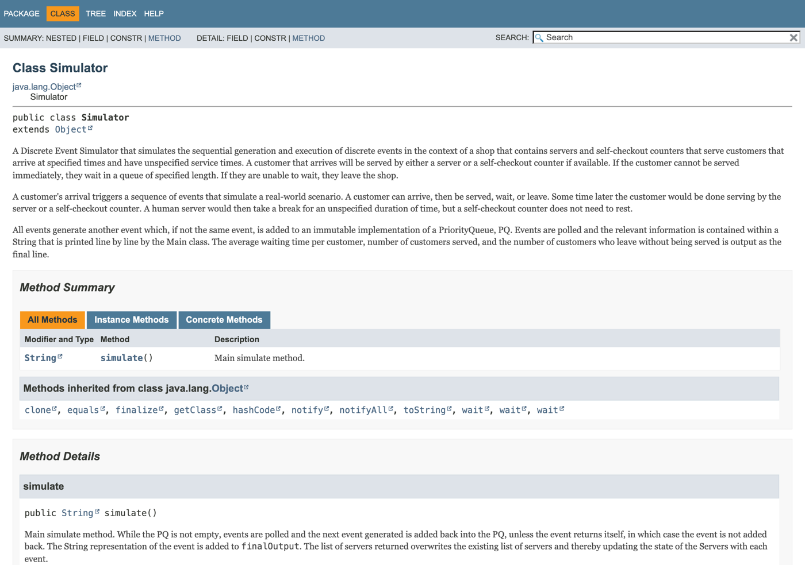

<div align="center">

# Discrete Event Simulator

**A shop simulation in purely immutable Java: customers, servers who take breaks, self-checkouts
and queues.**<br>
Every event produces the next one through an immutable priority queue, with no setters and no
side effects outside `main`. For NUS CS2030 *Programming Methodology II*. Written entirely in Vim,
with full Javadocs.

[](https://github.com/sp4ce-cowboy/discrete-event-simulator/blob/013aa28a67f6bd67c64cfcd61fdc23a33f8f4f3a/99_FinalProject/Simulator.java#L142-L184)
[](https://sp4ce-cowboy.github.io/discrete-event-simulator/)
[](README-ORIGINAL.md)


</div>

> [!NOTE]
> This consolidated README page was added by
> [Claude Opus 5.5](https://docs.anthropic.com/en/docs/claude-code) in Nov 2026 using my
> [agentic-repo-analysis](https://github.com/sp4ce-cowboy/agentic-workflows) skill, from the
> project's code and Javadocs. The project itself is from Feb – Mar 2023. The original README is
> in **[README-ORIGINAL.md](README-ORIGINAL.md)**; the API documentation is
> **[on GitHub Pages](https://sp4ce-cowboy.github.io/discrete-event-simulator/)**.

## At a glance

| | |
|---|---|
| **What** | A discrete event simulator of a shop: customers arrive at given times, are served by a human server or a self-checkout, wait in bounded queues, or leave. Human servers rest at random after each customer |
| **Context** | NUS [CS2030](https://nusmods.com/courses/CS2030/programming-methodology-ii) *Programming Methodology II*, AY2022/23 Semester 2, the course's final project (individual) |
| **Output** | Every event in time order, then the average wait, the number served and the number who left |
| **Stack** | Java 17, Javadoc; written in Vim |

## Documentation

Every class and method has a Javadoc comment, and the generated API reference is
**[hosted on GitHub Pages](https://sp4ce-cowboy.github.io/discrete-event-simulator/)** in the JDK's own style: class summaries that explain the
design, method details with parameters and return values, a class tree, an index and search.

[](https://sp4ce-cowboy.github.io/discrete-event-simulator/Simulator.html)

Good places to start: [`Simulator`](https://sp4ce-cowboy.github.io/discrete-event-simulator/Simulator.html) (the event loop),
[`Event`](https://sp4ce-cowboy.github.io/discrete-event-simulator/Event.html) (the abstract event and its contract),
[`PQ`](https://sp4ce-cowboy.github.io/discrete-event-simulator/PQ.html) and [`ImList`](https://sp4ce-cowboy.github.io/discrete-event-simulator/ImList.html) (the immutable collections) and
[`QManager`](https://sp4ce-cowboy.github.io/discrete-event-simulator/QManager.html) (the self-checkout queue rules).

## How it works

- **Events:** `ArriveEvent`, `WaitEvent`, `ServeEvent`, `DoneEvent` and `LeaveEvent` extend an
  abstract `Event`. Each implements `nextEvent(servers)`, which returns a `Pair` of the next event
  and a new list of servers; an event that returns itself is finished.
- **The loop** ([`simulate`](https://github.com/sp4ce-cowboy/discrete-event-simulator/blob/013aa28a67f6bd67c64cfcd61fdc23a33f8f4f3a/99_FinalProject/Simulator.java#L142-L184)):
  poll the queue, ask the event for its successor, add it back, replace the server list, and add
  the event's own statistics (served, left, waiting time).
- **Immutability:** `ImList` and `PQ` return a new copy on every change, so no event changes
  shared state.
- **Randomness:** service and rest times are `Supplier<Double>`s, drawn only when needed, from a
  seeded `Random`, so runs repeat.

## Skills covered

| Skill | Where it shows (click the links for the code) | Docs |
|---|---|---|
| **Technical documentation**<br> | Javadoc on every class and method, [hosted in JDK API style](https://sp4ce-cowboy.github.io/discrete-event-simulator/) | [Javadoc guide](https://www.oracle.com/technical-resources/articles/java/javadoc-tool.html) |
| **Object-oriented design**<br> | An abstract event with five subclasses, each owning its transition: [`WaitEvent.nextEvent`](https://github.com/sp4ce-cowboy/discrete-event-simulator/blob/013aa28a67f6bd67c64cfcd61fdc23a33f8f4f3a/99_FinalProject/WaitEvent.java#L67-L160); `SelfCheck` extending `Server` | [Java tutorials: inheritance](https://docs.oracle.com/javase/tutorial/java/IandI/subclasses.html) |
| **Immutable, effect-free programming** | Immutable list and priority queue that return new copies: [`ImList`](https://github.com/sp4ce-cowboy/discrete-event-simulator/blob/013aa28a67f6bd67c64cfcd61fdc23a33f8f4f3a/99_FinalProject/ImList.java#L13-L207), [`PQ`](https://github.com/sp4ce-cowboy/discrete-event-simulator/blob/013aa28a67f6bd67c64cfcd61fdc23a33f8f4f3a/99_FinalProject/PQ.java#L26-L92) | |
| **Generics and functional interfaces** | `ImList<E>`, `PQ<E>`, `Pair<T, U>`, `Comparator<Event>`, `Supplier<Double>` for lazy random values | [java.util.function](https://docs.oracle.com/en/java/javase/17/docs/api/java.base/java/util/function/package-summary.html) |
| **Simulation** | Event scheduling, bounded queues, exponential rest periods, summary statistics: [`Simulator`](https://github.com/sp4ce-cowboy/discrete-event-simulator/blob/013aa28a67f6bd67c64cfcd61fdc23a33f8f4f3a/99_FinalProject/Simulator.java) | |

## Coding stats

The final code is 1,679 lines of Java in 16 files; by the course's design, the labs that led up
to it came to about 10,000 lines.

## On my resume

**Skills:** Java 17 · technical documentation (Javadoc) · object-oriented design · immutability · generics · functional interfaces · discrete event simulation

- Documented every class and method with Javadoc, explaining the design and each method's contract, and published the API reference on GitHub Pages in JDK style.
- Built a discrete event simulator of a shop in Java 17 (1.7k lines): customers arrive, are served by human servers or self-checkouts, wait in bounded queues or leave, and servers rest at random.
- Designed it to be fully immutable and effect-free: an immutable list and priority queue that return new copies, events that return their successor and a new server list as a `Pair`, and no setters or output outside `main`.
- Modelled five event types as subclasses of an abstract `Event`, each owning its own state transition, with a comparator that orders events by time and then customer, so every run is deterministic.
- Drew service and rest times lazily through `Supplier<Double>`, with seeded exponential rest periods, so random runs are reproducible.

## Getting started

```sh
cd 99_FinalProject
javac *.java
java Main < tests/test1.in
```
