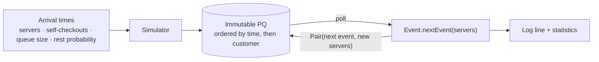
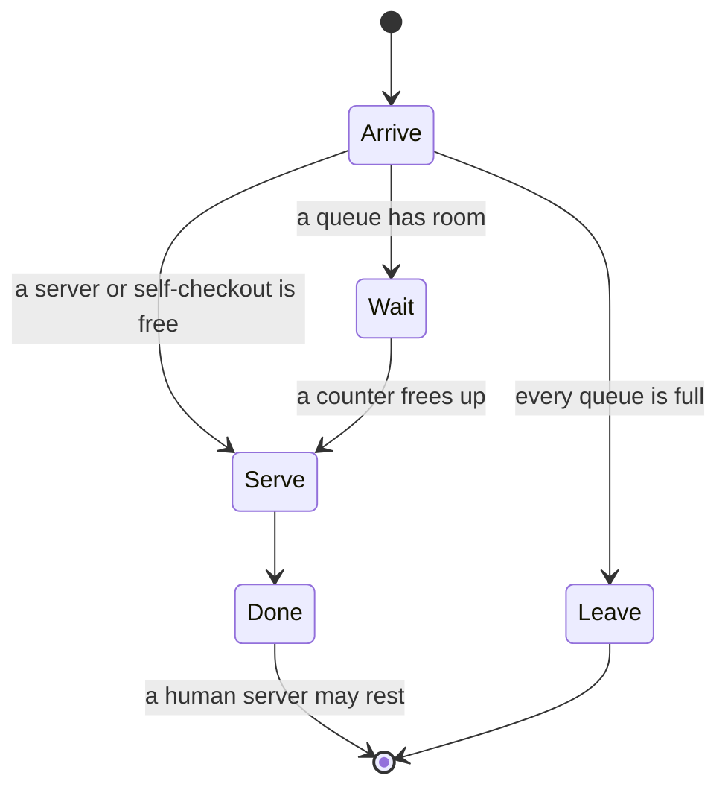

# Discrete Event Simulator

**A shop simulation in purely immutable Java: customers, servers who take breaks, self-checkouts
and queues.** 
Every event produces the next one through an immutable priority queue, with no setters and no
side effects outside `main`. For NUS CS2030 *Programming Methodology II*. Written entirely in Vim,
with full Javadocs.

> [!NOTE]
> This consolidated README page was added by
> [Claude Opus 5.5](https://docs.anthropic.com/en/docs/claude-code) in Nov 2026 using my
> [agentic-repo-analysis](https://github.com/sp4ce-cowboy/agentic-workflows) skill, from the
> project's code and Javadocs. The project itself is from Feb – Mar 2023. The original README is
> in **[README-ORIGINAL.md](README-ORIGINAL.md)**; the API documentation is
> **[on GitHub Pages](https://sp4ce-cowboy.github.io/discrete-event-simulator/)**.

## At a glance

| | |
|---|---|
| **What** | A discrete event simulator of a shop: customers arrive at given times, are served by a human server or a self-checkout, wait in bounded queues, or leave. Human servers rest at random after each customer |
| **Context** | NUS [CS2030](https://nusmods.com/courses/CS2030/programming-methodology-ii) *Programming Methodology II*, AY2022/23 Semester 2, the course's final project (individual) |
| **Output** | Every event in time order, then the average wait, the number served and the number who left |
| **Stack** | Java 17, Javadoc; written in Vim |

## How it works

- **Events:** `ArriveEvent`, `WaitEvent`, `ServeEvent`, `DoneEvent` and `LeaveEvent` extend an
  abstract `Event`. Each implements `nextEvent(servers)`, which returns a `Pair` of the next event
  and a new list of servers; an event that returns itself is finished.
- **The loop** ([`simulate`](https://github.com/sp4ce-cowboy/discrete-event-simulator/blob/013aa28a67f6bd67c64cfcd61fdc23a33f8f4f3a/99_FinalProject/Simulator.java#L142-L184)):
  poll the queue, ask the event for its successor, add it back, replace the server list, and add
  the event's own statistics (served, left, waiting time). No event changes shared state.
- **Immutability:** `ImList` wraps `ArrayList` and returns a new list on every change;
  [`PQ`](https://github.com/sp4ce-cowboy/discrete-event-simulator/blob/013aa28a67f6bd67c64cfcd61fdc23a33f8f4f3a/99_FinalProject/PQ.java#L26-L92)
  does the same for `PriorityQueue`, and `poll` returns the element with the new queue as a `Pair`.
- **Ordering:** [`EventComp`](https://github.com/sp4ce-cowboy/discrete-event-simulator/blob/013aa28a67f6bd67c64cfcd61fdc23a33f8f4f3a/99_FinalProject/EventComp.java)
  sorts by timestamp, then by customer, so ties resolve the same way every run.
- **Randomness, lazily:** service and rest times are `Supplier<Double>`s, so a value is drawn only
  when an event needs it. Rest periods are exponential, from a seeded `Random`, so runs repeat.
- **Self-checkouts:** `SelfCheck` extends `Server` with a zero rest time. A self-checkout's queue
  affects all the others, so `QManager` holds those rules for the whole list of counters.

## Skills shown

| Skill | Where it shows (click the links for the code) | Docs |
|---|---|---|
| **Object-oriented design**  | An abstract event with five subclasses, each owning its transition: [`WaitEvent.nextEvent`](https://github.com/sp4ce-cowboy/discrete-event-simulator/blob/013aa28a67f6bd67c64cfcd61fdc23a33f8f4f3a/99_FinalProject/WaitEvent.java#L67-L160); `SelfCheck` extending `Server` | [Java tutorials: inheritance](https://docs.oracle.com/javase/tutorial/java/IandI/subclasses.html) |
| **Immutable, effect-free programming** | Immutable list and priority queue that return new copies: [`ImList`](https://github.com/sp4ce-cowboy/discrete-event-simulator/blob/013aa28a67f6bd67c64cfcd61fdc23a33f8f4f3a/99_FinalProject/ImList.java#L13-L207), [`PQ`](https://github.com/sp4ce-cowboy/discrete-event-simulator/blob/013aa28a67f6bd67c64cfcd61fdc23a33f8f4f3a/99_FinalProject/PQ.java#L26-L92) | |
| **Generics and functional interfaces** | `ImList<E>`, `PQ<E>`, `Pair<T, U>`, `Comparator<Event>`, `Supplier<Double>` for lazy random values | [java.util.function](https://docs.oracle.com/en/java/javase/17/docs/api/java.base/java/util/function/package-summary.html) |
| **Simulation** | Event scheduling, bounded queues, exponential rest periods, summary statistics: [`Simulator`](https://github.com/sp4ce-cowboy/discrete-event-simulator/blob/013aa28a67f6bd67c64cfcd61fdc23a33f8f4f3a/99_FinalProject/Simulator.java) | |
| **Documentation** | Javadoc on every class and method, [hosted in JDK API style](https://sp4ce-cowboy.github.io/discrete-event-simulator/) | [Javadoc guide](https://www.oracle.com/technical-resources/articles/java/javadoc-tool.html) |

## Coding stats

Not tracked: this predates my WakaTime use (from Oct 2023), and the repo is an archive uploaded in
Sep 2023. The final code is 1,543 lines of Java in 15 files plus the abstract `Event`; by the
course's design, the labs that led up to it came to about 10,000 lines.

## On my resume

**Skills:** Java 17 · object-oriented design · immutability · generics · functional interfaces · discrete event simulation · Javadoc

- Built a discrete event simulator of a shop in Java 17 (1.5k lines, 16 classes): customers arrive, are served by human servers or self-checkouts, wait in bounded queues or leave, and servers rest at random.
- Designed it to be fully immutable and effect-free: an immutable list and priority queue that return new copies, events that return their successor and a new server list as a `Pair`, and no setters or output outside `main`.
- Modelled five event types as subclasses of an abstract `Event`, each owning its own state transition, with a comparator that orders events by time and then customer, so every run is deterministic.
- Drew service and rest times lazily through `Supplier<Double>`, with seeded exponential rest periods, so random runs are reproducible.
- Documented every class and method with Javadoc and published the API reference on GitHub Pages.

## Getting started

The abstract `Event` class didn't make it into this archive, so the code doesn't compile as it
stands; its API is in the [Javadocs](https://sp4ce-cowboy.github.io/discrete-event-simulator/).
The sample inputs are in [`99_FinalProject/tests`](99_FinalProject/tests).
